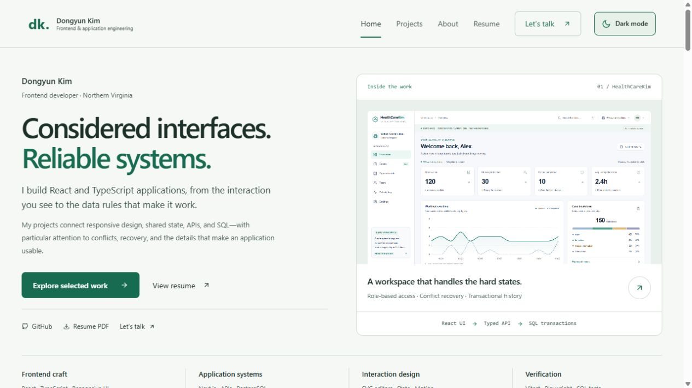

# Dongyun Kim — Front-End Developer Portfolio

**Considered interfaces. Reliable systems.**

A personal portfolio connecting responsive interface craft with application state, APIs, SQL workflows, and documented engineering decisions. The homepage puts live projects before the detailed technology inventory.

### [Visit the portfolio ↗](https://dongyunkim.vercel.app/)

[Explore projects](https://dongyunkim.vercel.app/project) · [About me](https://dongyunkim.vercel.app/about) · [Resume](https://dongyunkim.vercel.app/resume) · [Contact](https://dongyunkim.vercel.app/contact)

## Featured projects

The homepage and unfiltered project archive present these projects first, in this order:

| Project | Overview | Live site | Source |
| --- | --- | --- | --- |
| **01 · HealthCareKim** | A multi-clinic workspace for case triage, assignments, appointments, role-based access, and transactional audit history, with isolated synthetic demos on Neon. | [View site](https://health-care-kim.vercel.app/) | [View source](https://github.com/dongyunkim96/HealthCareKim) |
| **02 · CONVENE** | A full-stack conference platform with attendee registration, conflict-aware reservations, FIFO waitlists, QR passes, and organizer check-in. | [View site](https://convene-coral-six.vercel.app) | [View source](https://github.com/dongyunkim96/Convene) |
| **03 · SPACEFIT** | A dimension-based 2D home layout planner with an interactive SVG editor, browser drafts, and Firebase account storage. | [View site](https://space-fit-six.vercel.app/) | [View source](https://github.com/dongyunkim96/SpaceFit) |
| **04 · STILLROOM** | An editorial home fragrance storefront with scent recommendations, gift wrapping, and a complete demo checkout. | [View site](https://still-room-five.vercel.app/) | [View source](https://github.com/dongyunkim96/StillRoom) |
| **05 · Shilla Bakery** | A responsive bakery brand experience built with React, TypeScript, and Tailwind CSS. | [View site](https://shilla-bakery.vercel.app) | [View source](https://github.com/dongyunkim96/Shilla-Bakery) |
| **06 · PALETTE** | A photo-led café experience with 60 products, URL-based discovery, persistent favorites, and a three-flavor gelato builder. | [View site](https://palette-cafe-chi.vercel.app/) | [View source](https://github.com/dongyunkim96/PaletteCafe) |
| **07 · FORM LAB** | A 116-product keyboard storefront with compatibility-aware builds, optional 3D, shared configurations, and local demo checkout. | [View site](https://form-lab-kappa.vercel.app/) | [View source](https://github.com/dongyunkim96/FormLab) |
| **08 · WeatherWear** | A weather companion with outfit recommendations, commute layers, saved places, and trip packing lists. | [View site](https://weather-wear-coral.vercel.app) | [View source](https://github.com/dongyunkim96/WeatherWear) |
| **09 · CryptoPulse** | A cryptocurrency research dashboard with charts, asset search, a watchlist, and cached market data. | [View site](https://cryptopulse-snowy.vercel.app) | [View source](https://github.com/dongyunkim96/CryptoPulse) |

The complete archive contains **17 projects**, with filters for Applications, Web experiences, and Experiments. WeatherWear and CryptoPulse card visuals are interface illustrations; they do not display live forecast or market data.

## Design and user experience

- A project-led hero replaces the decorative code panel with an actual HealthCareKim interface and direct access to its engineering case study.
- All 17 project cards open internal description pages, with hover and keyboard-focus feedback. Four in-depth case studies explain context, contribution, architecture, decisions, tradeoffs, verification, limitations, and a guided demo workflow: HealthCareKim, CONVENE, SPACEFIT, and PALETTE. The other 13 pages provide project-specific introductions, implementation focus, technology, and source/demo links.
- Project cards expose implementation highlights and internal case-study links alongside the existing live-site and source actions.
- The skills section connects current frontend, full-stack, interaction, and testing tools to inspectable project evidence. It uses no proficiency percentages or invented business-impact metrics.
- A direct resume download, GitHub link, and contact paths are available from the hero.

- Two coordinated themes: the original navy/mint dark mode and a soft ivory/forest-green light mode.
- A keyboard-accessible header toggle remains available on desktop and mobile, saves the choice in `localStorage`, and restores it before React renders to avoid a theme flash. Dark is the default when no valid preference exists. Theme changes also synchronize across tabs; toggling still works when browser storage is unavailable.
- Theme-aware navigation, cards, code preview, filters, skill tags, buttons, and contact fields.
- Large **View site** and **View source** buttons on both homepage cards and the project archive.
- Primary site buttons and outlined source buttons make the two destinations easy to distinguish. Projects without a demo feature a primary source button.
- Project actions use **44px targets on compact homepage cards** and **48px targets in the archive**, with automatic wrapping when the card is narrow.
- Stationary cards, clear hover feedback, and visible keyboard focus make actions easier to select.
- External actions open in a new tab, with a visible note and project-specific accessible names.
- Mobile navigation, a skip-to-content link, reduced-motion support, and labeled contact fields.
- Lazy-loaded routes and images, page-specific titles, descriptive metadata, and a custom favicon.
- An expanded About page connects the published resume with project decisions, Coding Temple and CodeStates training, Army communications/leadership experience, Virginia Tech electrical engineering background, and listed certifications.
- An embedded PDF resume with direct open and download options.

## Technology

| Area | Tools |
| --- | --- |
| UI | React 18, JavaScript, CSS |
| Navigation | React Router 6 |
| Icons | React Icons |
| Build | Create React App / react-scripts |
| Tests | Jest, React Testing Library |
| Contact | Vercel Functions, Resend |
| Hosting | Vercel |

The portfolio itself uses JavaScript. Individual showcased applications also use TypeScript and other tools listed on their cards.

## Technical experience across projects

The homepage and About page share six skill groups, with related projects listed on each card. These describe project experience rather than proficiency ratings.

| Area | Technologies used |
| --- | --- |
| Frontend engineering | React, TypeScript, Next.js, Svelte / SvelteKit, HTML & CSS |
| Design & interaction | Tailwind CSS, SVG, Motion, Anime.js, Radix UI |
| State & API boundaries | TanStack Query, Zustand, React Context, React Router, tRPC, Zod |
| Server & persistence | PostgreSQL, Neon, SQLite, Firebase, Vercel Functions, Upstash Redis |
| Testing & recovery | Vitest, Jest, React Testing Library, Playwright, PGlite, ESLint |
| Build & delivery | Git, GitHub, npm, Vite, Vercel |

Cloudflare Workers and SQLite / Durable Objects refer to CryptoPulse’s alternative backend; its current deployment uses Vercel Functions and Upstash Redis. STILLROOM contributes React Context/reducer state, deterministic recommendations, stock-aware bag logic, and Motion/Radix interactions. Its checkout is a frontend demo with no payment processing. Playwright appears in STILLROOM and Shilla Bakery’s end-to-end test tooling. Tool presence does not imply that every deployment or browser check has been independently verified.

Skill content is maintained in `my-app/src/data/skills.js`; the shared presentation is in `my-app/src/components/Skills.js`. Resume-based About content is in `my-app/src/data/about.js`. Theme tokens are in `my-app/src/theme.css`, and the toggle is in `my-app/src/components/ThemeToggle.js`.

Case-study narratives live in `my-app/src/data/caseStudies.js` and share `my-app/src/components/Projects/CaseStudy.js`. Hiring-focused layout rules live in `my-app/src/career.css`. [Design and verification notes](docs/employer-redesign.md) record the scope and actual checks.



## Run locally

Use **Node.js 24** and npm. From the repository root:

```sh
cd my-app
npm ci
npm start
```

Open the local address printed by the development server, normally [localhost:3000](http://localhost:3000).

## Build and test

Run from `my-app/`:

```sh
npm run build
node node_modules/react-scripts/scripts/test.js --watchAll=false --runInBand
```

The 29 tests cover featured project order, filtering, all 17 project description pages, card-to-detail navigation, source-only projects, unknown-case recovery, mobile menu state, contact failure recovery, theme persistence, both toggle directions, invalid saved values, blocked storage, and cross-tab synchronization. Actual email delivery requires separate verification. The redesign's local browser checks and their limits are recorded in `docs/employer-redesign.md`.

## Routes

| Page | Route |
| --- | --- |
| Home | `/` |
| Project description | `/project/:projectId` for all 17 catalog IDs; four include in-depth engineering case studies |
| Projects | `/project` |
| About | `/about` |
| Resume | `/resume` |
| Contact | `/contact` |

`/projects` redirects to `/project`.

## Project structure

```text
my-app/
├── api/contact.js                     # Contact form function
├── public/                            # Favicon, metadata, and resume PDF
├── src/
│   ├── App.js                         # Routing and page titles
│   ├── App.test.js                    # User-flow regression checks
│   ├── components/
│   │   ├── Home/                      # Introduction and featured projects
│   │   ├── Projects/                  # Archive, cards, and action styles
│   │   ├── About/
│   │   ├── Resume/
│   │   └── Contact/
│   ├── data/projects.js               # Project order, copy, and links
│   └── style.css                      # Shared design system
└── vercel.json                        # SPA and API routing
```

To update project content, edit `my-app/src/data/projects.js`. Keep featured entries first; the homepage renders entries marked `featured: true` in the same order. Project button styling lives in `my-app/src/components/Projects/ProjectActions.css`.

## Deployment and contact

The public portfolio is available at **[dongyunkim.vercel.app](https://dongyunkim.vercel.app/)**.

For Vercel, set the root directory to `my-app`, the build command to `npm run build`, and the output directory to `build`. The included rewrites support direct navigation to application routes while retaining API routing.

Configure `RESEND_API_KEY` in the hosting environment to enable email delivery. Without it, the API reports that the service is unavailable; the interface retains the visitor’s message and offers a direct email link. Local `npm start` serves the interface; email delivery requires the deployed function. Never commit API keys.

Contact: [dongyunkim96@gmail.com](mailto:dongyunkim96@gmail.com) · [GitHub](https://github.com/dongyunkim96) · [LinkedIn](https://linkedin.com/in/dongyun-kim-363487272/)

